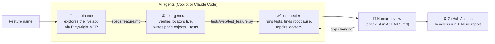

# AI-Assisted Test Automation Framework

[](https://github.com/ckleovoulou/playwright/actions/workflows/web-tests.yml)
[](https://github.com/ckleovoulou/playwright/actions/workflows/mobile-tests.yml)
[](https://ckleovoulou.github.io/playwright/)

A **Playwright + Pytest** framework in Python (Page Object Model) where AI agents do the heavy
lifting — **plan** tests by exploring the app, **generate** test code, and **heal** broken
locators — while a human reviews everything before it is merged. The same Pytest suite also runs
**Appium** smoke tests on an Android emulator, and both run headless in **GitHub Actions** with
**Allure** reports.

| | |
|---|---|
| **Web** | Playwright (sync API) · Pytest · pytest-xdist · Page Object Model |
| **Mobile** | Appium 2 · UiAutomator2 · Android emulator |
| **AI** | GitHub Copilot (agent mode) · Claude Code subagents · Playwright MCP |
| **Reporting / CI** | Allure · GitHub Actions · GitHub Pages |
| **Apps under test** | [saucedemo.com](https://www.saucedemo.com) (web) · Appium ApiDemos (Android) |

---

## How the AI workflow works



1. **Planner** opens the real site through the Playwright MCP server, reads the accessibility
   tree, explores happy paths, validation and edge cases, and writes a Markdown plan to
   [`specs/`](specs/).
2. **Generator** reads the plan, checks every locator against the live page, extends the
   existing page objects and writes the Pytest file, then runs it until it is green.
3. **Healer** runs failing tests, reproduces them in the browser and decides whether the
   locator, the flow, the data — or the app — is wrong. It fixes the page object, never the
   assertion; real bugs become a strict `xfail` with a reason.
4. **A human reviews** every plan and generated test against the checklist in
   [`AGENTS.md`](AGENTS.md) before merge.

**Guardrails:** all agents share one rulebook, [`AGENTS.md`](AGENTS.md): locator priority
(role → label/placeholder → `data-test` → CSS, no XPath), no fixed waits, assertions only in
tests, data in `framework/data.py`, and *never weaken an assertion to get green*.

| Agent | GitHub Copilot | Claude Code |
|---|---|---|
| Planner | [`.github/agents/test-planner.agent.md`](.github/agents/test-planner.agent.md) | [`.claude/agents/test-planner.md`](.claude/agents/test-planner.md) |
| Generator | [`.github/agents/test-generator.agent.md`](.github/agents/test-generator.agent.md) | [`.claude/agents/test-generator.md`](.claude/agents/test-generator.md) |
| Healer | [`.github/agents/test-healer.agent.md`](.github/agents/test-healer.agent.md) | [`.claude/agents/test-healer.md`](.claude/agents/test-healer.md) |
| Browser access | [`.mcp.json`](.mcp.json) (shared) | [`.mcp.json`](.mcp.json) (shared) |

> **Why custom agents instead of `npx playwright init-agents`?** Playwright's built-in test
> agents generate TypeScript for the Node test runner. This framework is Python/Pytest, so the
> agents here follow the same planner → generator → healer loop on top of the
> [Playwright MCP server](https://github.com/microsoft/playwright-mcp), with instructions
> tailored to this framework's page objects and conventions.

---

## Quick start

```bash
git clone https://github.com/ckleovoulou/playwright.git
cd playwright
```

Create and activate a virtual environment:

| Shell | Commands |
|---|---|
| macOS / Linux | `python3 -m venv .venv` then `source .venv/bin/activate` |
| Windows PowerShell | `py -m venv .venv` then `.venv\Scripts\Activate.ps1` |
| Windows cmd | `py -m venv .venv` then `.venv\Scripts\activate.bat` |
| Git Bash | `python -m venv .venv` then `source .venv/Scripts/activate` |

> PowerShell says *"running scripts is disabled"*? Run once:
> `Set-ExecutionPolicy -Scope CurrentUser RemoteSigned`

Install and run:

```bash
pip install -r requirements.txt
playwright install chromium

pytest tests/web                 # all web tests (headless)
pytest tests/web -m smoke        # smoke only
pytest tests/web -n auto         # in parallel
pytest tests/web/test_checkout.py --headed --slowmo 300   # watch it run
```

### Allure report

```bash
# needs Java 11+; or install the CLI with: npm i -g allure-commandline
npx allure-commandline serve allure-results
```

The latest CI report is published at **https://ckleovoulou.github.io/playwright/**.

---

## Using the agents

You need Node.js 18+ (for the Playwright MCP server, started automatically with `npx`).

**GitHub Copilot: VS Code**
1. Open the repo in VS Code. Copilot reads the `playwright` MCP server from `.mcp.json`
   in the repo root; start it with *MCP: List Servers → playwright → Start*.
2. Open Copilot Chat, pick **test-planner** in the agent dropdown and ask:
   `Plan tests for the product details page`.
3. Click the **Generate tests** hand-off (or switch to **test-generator**), then
   **test-healer** if anything fails.

**GitHub Copilot: PyCharm / other JetBrains IDEs**
1. Copilot Chat → **Agent** mode → tools icon → **Add MCP Tools** (opens Copilot's `mcp.json`)
   and add the same server as in [`.mcp.json`](.mcp.json):
   `"playwright": { "command": "npx", "args": ["@playwright/mcp@latest"] }` inside `"servers"`.
2. The agents in `.github/agents/` appear in the Copilot Chat agent dropdown. Use them as above;
   if hand-off buttons don't show, switch agents from the dropdown.

**Claude Code**
```bash
claude                      # in the repo root; approve the playwright MCP server from .mcp.json
> Use the test-planner agent to plan tests for the product details page
> Use the test-generator agent to implement specs/product-details.md
> Use the test-healer agent to fix failing tests in tests/web
```

Review the result with the checklist in [`AGENTS.md`](AGENTS.md), then commit.

---

## Mobile tests (Appium)

```bash
npm install -g appium
appium driver install uiautomator2
gh release download -R appium/android-apidemos -p "*.apk" -D apps   # see apps/README.md

# start an Android emulator (Android Studio > Device Manager), then:
appium &                         # server on http://127.0.0.1:4723
pytest tests/mobile
```

Without an emulator, Appium server or APK, the mobile tests **skip** locally. In CI they
**fail** instead (`REQUIRE_MOBILE=1`), so a broken setup can't pass silently.

---

## CI/CD

| Workflow | Trigger | What it does |
|---|---|---|
| [`web-tests.yml`](.github/workflows/web-tests.yml) | push, PR, weekly | ruff lint → Playwright tests headless & parallel → Allure report → GitHub Pages; traces uploaded on failure |
| [`mobile-tests.yml`](.github/workflows/mobile-tests.yml) | manual, weekly, mobile changes | KVM-accelerated headless Android emulator → Appium → Pytest → Allure report artifact |

---

## Project structure

```
├── AGENTS.md                  # shared rules for every AI agent (and humans)
├── CLAUDE.md                  # Claude Code entry point (imports AGENTS.md)
├── .github/
│   ├── agents/                # Copilot custom agents: planner, generator, healer
│   ├── copilot-instructions.md
│   └── workflows/             # web + mobile CI
├── .claude/agents/            # Claude Code subagents: planner, generator, healer
├── .mcp.json                  # Playwright MCP server (shared by Claude Code and Copilot)
├── specs/                     # Markdown test plans (planner output, reviewed by a human)
├── framework/
│   ├── config.py              # users, URLs, env settings
│   ├── data.py                # products, customers, expected messages
│   ├── pages/                 # Playwright page objects
│   └── mobile/                # Appium screen objects
└── tests/
    ├── conftest.py            # report hook, auto web/mobile markers
    ├── web/                   # login, inventory, checkout
    └── mobile/                # Android smoke tests
```

## Design decisions

- **Page objects return page objects** (`inventory.add_to_cart(...).go_to_cart().checkout()`),
  so tests read like user journeys.
- **Assertions only in tests**, using Playwright's auto-waiting `expect`. No sleeps anywhere.
- **`get_by_test_id` mapped to `data-test`**, the attribute Sauce Demo uses.
- **Screenshots attached to Allure on failure** for both web and mobile; Playwright traces
  kept on failure in CI.
- **Markers:** `smoke` / `regression`, plus `web` / `mobile` added automatically by folder.
